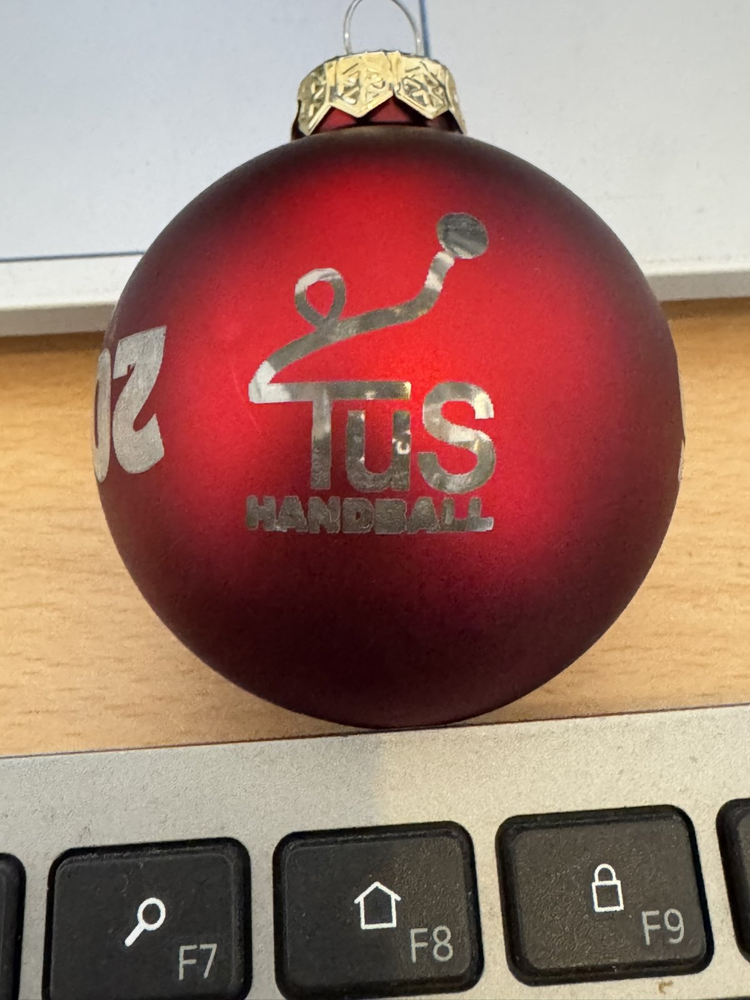
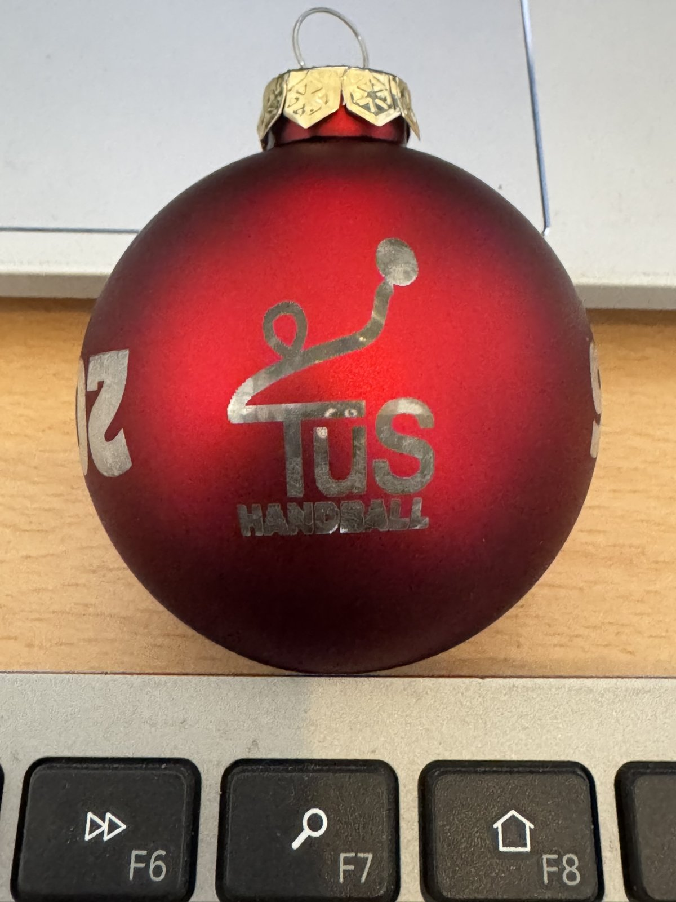

<p align="center"></p>

# Sphere Laser Warp

[](https://github.com/StefanRiese/sphere-laser-warp/actions/workflows/pages.yml)
[](https://stefanriese.github.io/sphere-laser-warp/)
[](LICENSE)
[](https://github.com/StefanRiese/sphere-laser-warp/commits/main)
[](https://github.com/StefanRiese/sphere-laser-warp/stargazers)


A browser tool that pre-distorts a flat image so that, once engraved on a ball
(for example a glass Christmas bauble) with a rotary unit, it looks **undistorted**.

**Use it:** https://stefanriese.github.io/sphere-laser-warp/

Everything runs client-side as a static site on GitHub Pages. Images are never uploaded.
The interface is available in English and German and in a light or dark theme (switches in the top right; the theme follows the system by default).

## Usage

1. Pick a machine preset (xTool M1 + RA2 Pro is included) and load an image
   (PNG, JPG, SVG and other browser-supported formats), or start with the built-in sample.
2. Enter the ball diameter and define the image size by width or height (in mm, on the ball).
3. Set which image direction runs along the rotation axis (angle, 0° = horizontal,
   90° = vertical) and, if needed, move the image along the axis.
4. Check the result in the flat preview and in the 3D ball preview. The 3D preview can also show
   the original image without warp, for comparison.
5. Download the **PNG** (it carries its DPI, so it imports at the right size) or the **SVG**
   (physical size in mm, raster embedded) and import it in xTool Studio or LightBurn.
6. In rotary mode set the object diameter to the ball diameter. The export orientation can be
   switched between rotation along the image height and along the image width.

Your settings are remembered in the browser and mirrored in the page address, so you can copy the
URL to share or bookmark a setup (the image itself is not part of it).

Import behaviour of the SVG in xTool Studio is untested; use the PNG if it misbehaves.

### Vector export

If you loaded an SVG, **Download vector SVG (paths)** warps the artwork itself instead of a raster:
every path is sampled, mapped onto the ball and written as a polyline in mm, so lines stay crisp at
any size. Fills, strokes and fill rules (including holes) are kept; stroke widths stay constant in mm.
Text must be converted to outlines first; text, images, `<use>`, gradients, patterns, clip paths and
masks are not exported and the tool says so. The same size, axis direction, offset and orientation
settings apply.

## Result

The same logo engraved on a matte red glass bauble with an xTool M1 + RA2 Pro: left with the
image warped by this tool, right with the plain, unwarped image.

| With Sphere Laser Warp | Without warp |
| :---: | :---: |
|  |  |

## How it works

For a ball of radius R with a horizontal rotary axis and the beam from the top:

- axis position `x = R·sin φ`, rotation angle `θ = λ` (latitude φ, longitude λ)
- the image is placed on the sphere with a chosen projection: azimuthal equidistant (default),
  stereographic (no shape stretch) or Lambert equal-area
- the output raster is resampled (bilinear) so columns map to axis position and rows to rotation
- relative to a cylinder of the same diameter, width is scaled by `1/cos φ` and height by `cos φ`

On a sphere, rows of the engraving are circles of latitude. Away from the equator they are
shorter and the surface tilts away from the beam, so a flat image engraved as is gets stretched.
This tool applies the inverse warp.

The output file covers exactly the area the image occupies, nothing more. There is no latitude
limit: far from the top of the ball the laser spot elongates and defocuses, so the info line shows
how far from the equator the image reaches. Keep large images modest.

## Target hardware

Developed for an **xTool M1** with an **RA2 Pro** rotary in **chuck mode** (the ball is clamped
and rotated directly, no rollers), using xTool Studio or LightBurn in rotary mode. Other gantry or
rotary setups should work through the generic PNG export. More presets are plain JSON files in
`presets/`.

## Notes on glass

A blue diode laser barely marks clear glass. Engrave a coating (the silvered or paint layer on a
bauble) or apply a black paint or spray layer. Test on a spare ball first.

## Development

```sh
npm install
npm run dev        # local dev server
npm test           # unit tests (projection, warp, presets, i18n)
npm run typecheck  # tsc --noEmit
npm run build      # typecheck + production build into dist/
```

Stack: TypeScript, Vite, a Web Worker for the warp, three.js (lazy-loaded) for the 3D preview.
Pushes to `main` run the tests and deploy to GitHub Pages through GitHub Actions.

## Roadmap

- [x] Upload (raster and SVG), live warp preview, PNG and SVG export
- [x] 3D ball preview with rotation axis and without-warp comparison
- [x] Machine presets, English and German UI
- [x] SVG path warp (true vector output)
- [x] Settings remembered and shareable through the URL hash
- [ ] Tiled mode for large images

Out of scope: G-code generation and roller-drive rotaries.

## Support

The tool is free. If it saved you some test balls, you can [donate via PayPal.me](https://www.paypal.me/stefanriese) (the "Donate" / "Spenden" button on the site does the same).

## Contributing

Issues and presets for other machines are welcome.

## License

[MIT](LICENSE)
